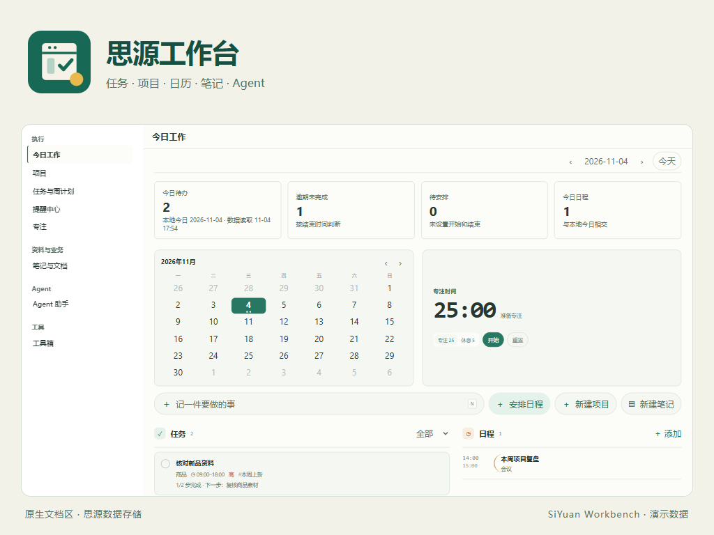
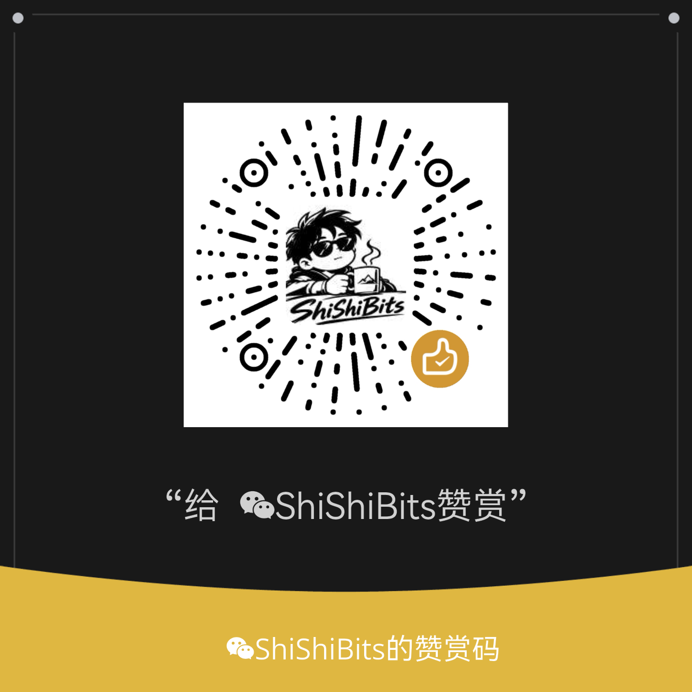

# SiYuan Workbench


Tasks, projects, calendar, notes and Agent workflows inside SiYuan's document area.



Version **1.11.1** · Requires **SiYuan 3.8.9+** · The interface is primarily Simplified Chinese.

The daily briefing puts assignments needing review or additional information first and opens the exact assignment. Daily tasks, events, mini calendar, focus timer, overview, task planning and the full calendar remain accessible. The briefing uses retrieved workbench records; connecting a separate material-management system is future work.

The full calendar shows the selected day's agenda on the left and the calendar on the right. Switch to upcoming events for today and the next six days. Use New event to schedule the selected day. The small calendar's Today button returns to the current month and selects today.

Delete an assignment from its detail page after confirming the scope. This removes its document and any notes inside it while retaining linked tasks and deliverable documents. Cancel active assignments first and reconcile pending results before deletion.

Cancel a running assignment from the assignment page and keep previously saved work. For interrupted assignments, check for an existing deliverable to send it for review. Selected assignments use rounded cards with wrapping titles.

Answer Agent questions in the sidebar or in the workbench to continue the same request. Workbench tools let the Agent list today's tasks, create or complete a task, and create an event. Attachments are shared as SiYuan resource references. Reading their contents requires a suitable enabled tool. If a connection fails, check any operations already performed before sending again.

The reminders sidebar hides completed tasks while retaining scheduled events. The full reminder center keeps completed-task history; reopening a task and refreshing restores its reminder in the sidebar.

## Features

- Daily overview, calendar, Pomodoro timer and quick task/project/note creation.
- Task cards, board and quadrant views, drag scheduling, checklists, templates and recurring tasks.
- Side pages for task properties and native project documents.
- Notes, unified notebook search, saved filters and reminders.
- Native Agent chat with Markdown, attachments, sidebar access and reviewed task assignments.
- A local toolbox for trusted HTML/JavaScript tools, without a separate background service.

## Getting started

After marketplace approval, search for SiYuan Workbench in Settings → Marketplace → Plugins. For local installation, download `package.zip` from this repository's Releases and use SiYuan's native local-plugin installer.

Enable the plugin and its Kernel trust, select a notebook in plugin settings, then open Workbench from the top bar. Project databases can be created from the project page.

Task properties and checklists use explicit Save. The native task body is stored separately; changing structured detail does not overwrite an existing rich document. Completing checklist steps does not automatically complete the parent task.

## Boundaries

Records and attachments stay in the SiYuan workspace. Reminders and recurring tasks require SiYuan to run; offline or sleeping-device delivery is not guaranteed. Windows, SiYuan 3.8.9 browser-desktop and its real Kernel have been verified. Other platforms, the Electron shell and simultaneous cross-device editing require separate validation.

Agent uses your SiYuan models and approval rules. Sending or running a request may incur model charges. Review generated results before adopting them. Sidebar chat and full-workbench chat are separate sessions. Install only trusted toolbox code.

SiYuan's public-document publishing service is not supported. That service is separate from distributing this plugin through the marketplace.

## Optional support

All features are available without a donation. Expand Support development in plugin settings to view the bundled original QR images offline.

<details>
<summary>Alipay / WeChat</summary>

| Alipay | WeChat |
| --- | --- |
|  |  |

</details>

## Build

```sh
pnpm install --frozen-lockfile
pnpm run build
```

Sources are in `src/`, `ui/` and `tools-src/`; build output is in `dist/`. Validate marketplace resources with `node scripts/Validate-Marketplace.mjs --directory dist`.

## License

[MIT](LICENSE) · Copyright 2026 ShiShiBits. See [third-party notices](THIRD-PARTY-NOTICES.md).

[Report an issue](https://github.com/ShiShiBits1/siyuan-workbench/issues) · [简体中文](README.zh-CN.md)
