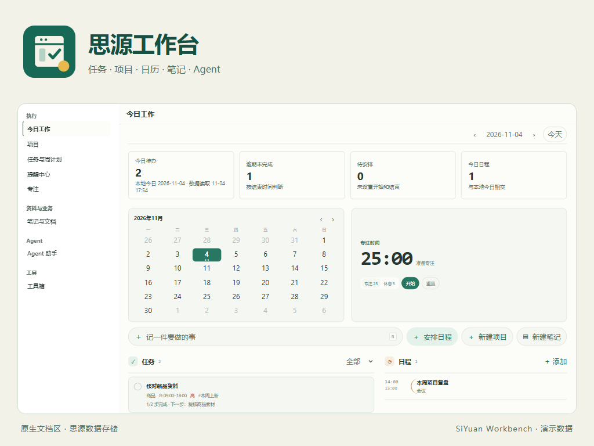
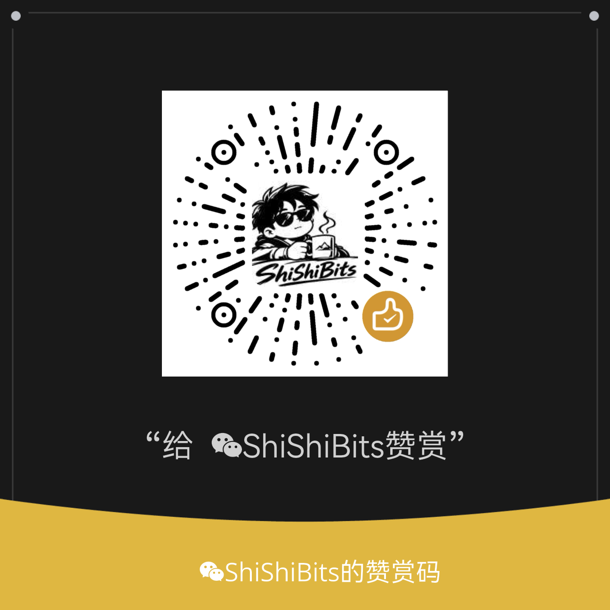

# 思源工作台


把任务、项目、日历、笔记和 Agent 放进思源原生文档区。



## 功能

- 今日工作：待办概览、小日历、专注计时，以及任务、项目、日程和笔记快捷入口。
- 任务中心：列表、看板、四象限、拖动安排、子任务、模板和固定日历重复任务。
- 右侧编辑页：直接编辑任务属性、附件和步骤；项目使用原生文档及数据库属性。
- 日历和提醒：月/周视图、确认改期、会话内撤销、任务及日程提醒。
- 笔记与搜索：管理笔记、统一检索当前笔记本、保存常用筛选。
- Agent：Markdown 聊天、图片和文件附件、侧栏入口、任务委托与人工验收。
- 工具箱：按客户端安装受信任的自研 HTML/JavaScript 工具，无额外后台服务。

界面以简体中文为主。当前版本 **1.10.1**，最低要求 **SiYuan 3.8.9**。

## 安装与开始

市场收录后，可在思源「设置 → 集市 → 插件」搜索「思源工作台」。也可以从本仓库 Releases 下载 `package.zip`，使用思源原生本地插件安装入口安装。

1. 启用插件及其 Kernel 插件信任。
2. 在插件设置中选择保存工作台数据的笔记本。
3. 从顶部工作台图标打开文档区标签页；按需展开任务、提醒、番茄钟或 Agent 侧栏。
4. 新建项目时可由插件创建原生项目数据库，无需手动填写数据库 ID。

任务属性与子任务点击「保存任务」生效。原生正文在下方独立编辑；任务属性中的详细内容与已建立的原生正文分别保留。子任务完成不会自动完成父任务。

## 数据与使用边界

业务记录和附件保存在思源工作空间中。禁用插件不删除业务文档；删除任务需确认，附件资源不会因解除关联而删除。

提醒和重复计划依赖思源运行，不保证退出、设备休眠时准时触发。已验证 Windows、SiYuan 3.8.9 的 browser-desktop 与真实 Kernel；其他平台、Electron 外壳和跨设备同时编辑需要各自验证。

Agent 使用思源已有模型和审批设置；只有发送或执行操作才会调用模型。模型可能产生费用，回复及成果需要自行核对。侧栏与完整工作台聊天是独立会话。工具箱仅安装可信代码，不把 iframe 隔离当作恶意代码的完整防护。

不支持思源的公开文档发布服务；它与插件集市上架是两项独立功能。

## 支持开发

所有功能均可直接使用，打赏完全自愿。插件设置中展开「支持开发 / 打赏」，可离线查看以下原图并放大扫码。

<details>
<summary>支付宝打赏 / 微信赞赏</summary>

| 支付宝 | 微信 |
| --- | --- |
|  |  |

</details>

## 开发

源码包含 `src/`、`ui/` 和 `tools-src/`。安装 Node.js 与 pnpm 后：

```sh
pnpm install --frozen-lockfile
pnpm run build
```

构建产物位于 `dist/`。发行资源清单见 `scripts/package-files.json`；可用 `node scripts/Validate-Marketplace.mjs --directory dist` 检查市场元信息和资源。

## 许可证

[MIT](LICENSE) · Copyright 2026 ShiShiBits。依赖通知见 [THIRD-PARTY-NOTICES.md](THIRD-PARTY-NOTICES.md)。

[问题反馈](https://github.com/ShiShiBits1/siyuan-workbench/issues)
